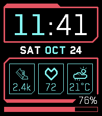
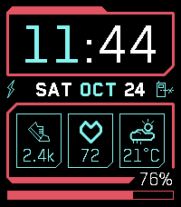

# Cyberpunk Watchface

A Pebble Time 2 watchface inspired by the Cyberpunk 2077 video game.




There are three cards that can be displayed. Current display options are:

- Steps
- Heart rate
- Current temperature and dominant weather condition of the day
- UV index

Other features:
- 12h or 24h Time format selection
- Battery percentage is displayed in the bottom right and a progress bar is visible along the bottom
- Vibrate and display an icon to the right of the date if the watch is disconnected from the phone
- Display an icon to the left of the date when the watch is charging

## Build and run

```sh
pebble build
pebble install --emulator emery --vnc
pebble screenshot --emulator emery --vnc --no-open screenshot_emery.png
```

`--vnc` is required in headless environments. The bundled output is
`build/pebble-cyberpunk-watchface.pbw`.

---

All icons are from: https://github.com/pebble-dev/iconography
